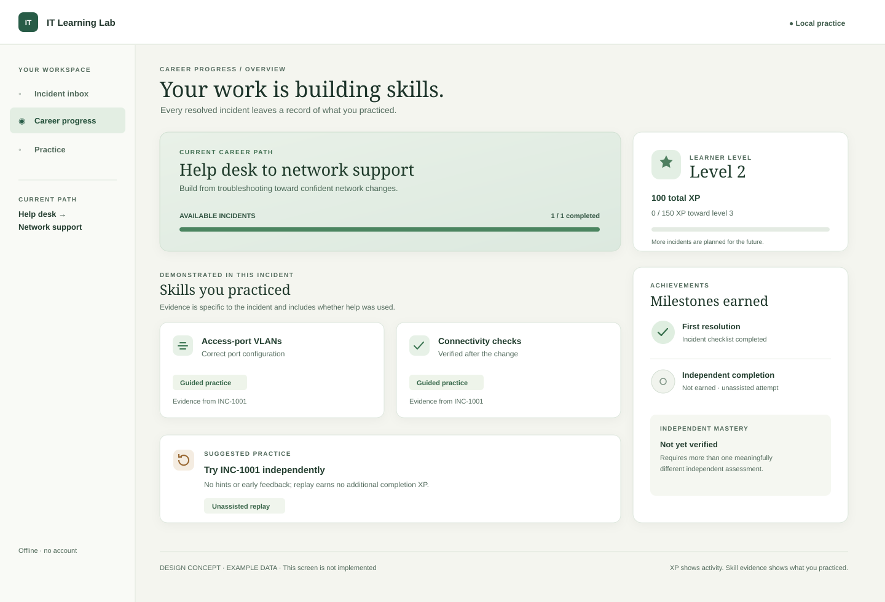

# Serious gamification: progression design

**Status:** proposal for review; no runtime behavior has been implemented.

**Foundation:** PR #1 at `18657b991da305ff1a4b7bb4143f7b861fb3678b`; changes here are separate from that PR.

**Purpose:** make hands-on learning feel like advancing through a fictional workplace while preserving honest evidence of technical skill.

[View the static progression-screen concept](progression-screen.svg) · [PNG preview](progression-screen.png)

The concept borrows broad ideas from Boot.dev's emphasis on [structured paths and hands-on practice](https://www.boot.dev/about), not its artwork, characters, wording, or proprietary presentation. The invented labels and numbers below are design proposals, not shipped features.

## 1. How progression works

| Concept | Meaning | What changes it |
| --- | --- | --- |
| **Incident** | A fictional workplace problem with a ticket, actions, a simulator and a deterministic assessment. | An officially authored incident is completed only when its current validator confirms the state and required actions. |
| **XP and level** | A visible record of completed learning activities. Neither is a measure of mastery or a job qualification. | An official incident's first validated completion awards its published XP once. Derive the level from total XP. |
| **Skill evidence** | A scoped record of what a learner demonstrated in a particular assessment. | An authored mapping associates validated results with stable competency IDs and records whether assistance was used. |
| **Achievement** | Recognition of a specific accomplishment, with a plain-language rule and evidence. | A trusted rule checks a qualifying completed attempt; it is recorded once. It does not award extra XP in this proposal. |
| **Career path** | An ordered collection of incidents and shared competencies relevant to a role. | Documented prerequisites use evidence or completion, never XP or level alone. Guided completion can unlock ordinary learning. |

**Example values for the proposed first implementation:** a first, validated INC-1001 completion awards **100 XP**, whether guided or independent. Level 1 starts at 0 total XP, level 2 at 100, and level 3 at 250; thresholds are illustrative and must be tuned as content grows. Progress toward level 3 after this incident is **0 of 150 XP**, not 100 of 150. Show total XP separately. An unfinished or invalid incident, an individual click, and a reset award 0 XP.

Make the journey tangible through an original **casebook**: a short briefing, visible stages for investigation and handoff, a consequential simulated action, and an after-action debrief. A path can show connected case milestones and the next available assignment, while completed cases remain replayable. The fictional workplace supplies context and continuity; it never supplies proof of competence. With only INC-1001 available, show its actual stages and clearly label later content as future work.

A first completion also earns a **First resolution** achievement, explicitly meaning the incident's current checklist passed. It is not a claim of professional competence. In a later increment, a qualifying unassisted replay may earn **Independent incident completion**, but adds no more XP for that incident. Viewing an incomplete skills report counts as assistance under PR #1's current rule, as do its hints; explain this before the learner opens it. Neither assistance nor mistakes reduce the first completion award, erase progress, or prevent another practice attempt.

## 2. Local data and versioning

The current foundation stores a versioned INC-1001 session in localStorage under `it-learning-lab.inc1001.v1`. It has no permanent XP ledger or trustworthy import provenance. Keep that working session intact; do not silently overwrite it to add progression.

**Proposed progression store:** one local IndexedDB database beginning at schema version 1, independent of the scenario and session version numbers. Increment the database version for future schema changes and apply explicit, tested forward migrations; reject unsupported newer versions without erasing data. After a successful migration, the active session and progression records share this database as the single authoritative store; the old localStorage entry remains a backup, not a second live writer. Use a single read/write transaction for each completion. Confirm browser and Windows WebView2 behavior before adopting it. Its minimal logical records are:

| Record | Example fields | Purpose |
| --- | --- | --- |
| `meta` | `schemaVersion`, `migrationVersion` | Validate and migrate the store. |
| `attempt` | `attemptId`, official incident family, definition/validator versions, mode, assistance flags, session state and revision | Preserve the active session and bounded attempt summaries; notes stay with the session, not duplicated in evidence records. |
| `receipt` | unique `xp:inc-1001`, `100`, qualifying `attemptId` | Immutable once-only XP award; total XP and level are derived from receipts. |
| `achievement` | `first-resolution`, qualifying `attemptId`, rule version | Once-only recognition, with the evidence used to grant it. |
| `skillEvidence` | stable `skillId`, assessment ID/version, outcome, assisted flag, attempt reference | A scoped observation usable by multiple paths. |

The receipt key identifies the **official incident family**, not the attempt, reset, text, import ID, or scenario-schema version. An author must deliberately publish a new, genuinely distinct eligible mission to create a new XP award; a version bump alone never does so. Bundle the official identity and validator in trusted application code. Imported scenarios remain usable for practice but award no XP or mastery, even if they reuse `INC-1001`; do not trust an imported file's own ID, rewards, or executable rules. Preserve the existing size and schema checks.

Validate a snapshot of the completed attempt. In one [IndexedDB read/write transaction](https://developer.mozilla.org/en-US/docs/Web/API/IDBTransaction), re-read its stored revision and trusted origin, abort and revalidate if they changed, then check the unique receipt and write the receipt and eligible records. All windows write the authoritative session through the same database. Display an award only after commit. The unique key and transaction protect against double-clicks and concurrent same-origin windows; failed or interrupted writes show a recoverable save error. If the required storage or safe concurrency is unavailable, do not silently report an unsaved reward.

**Migration:** read the existing v1 attempt, write its migrated session and a migration marker together in one new-database transaction, and leave the old entry untouched. If interrupted, retry safely using the marker; never claim atomicity across localStorage and IndexedDB. Preserve prior notes for viewing or replay. Since v1 cannot establish whether an identical-looking scenario was imported, do not automatically grant XP or mastery from an old session. Explain that a new completion of the bundled incident can earn its one award. A normal incident reset clears only the current attempt; it never clears the ledger. A separate, explicit erase-all action may delete local learning data and starts the whole profile from zero. Local data is editable and is not tamper-resistant; this is training feedback, not a secure examination or certification.

## 3. Validation and mastery

- **Incident completion:** use the existing `grade()` and adapter, recomputed from the current simulated state and validated actions. The printer port must be correct, connectivity must actually succeed, the required before/after observations must be present, and the current documentation checklist must pass. Do not award based on a button press, a learner's statement or previously passing connectivity after another change.
- **Assisted practice:** completing with hints or early report feedback still earns the same first-completion XP and First resolution achievement. Record the assistance transparently. A learner can practice again as often as desired without losing earned progress.
- **Independent incident completion:** a later rule may recognize a complete official attempt with independent mode, zero hints and no incomplete-report feedback, using PR #1's existing evidence. Label it as an **unassisted attempt**, including when the learner already knows the incident. It is not mastery.
- **Skill evidence:** for INC-1001, a validated correct port change can contribute scoped evidence to `network.access_vlan_configuration`; successful post-change checks can contribute to `network.connectivity_verification`. The answer choice alone is insufficient. Show whether the evidence was assisted and which incident supplied it.
- **Independent mastery, future:** require at least two separately authored, meaningfully different incident families assessing the same skill, each completed independently without solution-bearing help and with its own relevant state/verification checks. A reset, changed text, new version or duplicate import is not a distinct assessment. Define exact coverage before implementation. Do not award mastery for INC-1001 alone.
- **Documentation:** PR #1 uses keyword/length checks. Passing that checklist is not proof that a note is accurate or communication is mastered. Keep any communication-quality mastery claim locked until a more reliable deterministic rubric is designed and evaluated; do not introduce AI grading.

## 4. Shared career paths and practice

Skills are global IDs with evidence references; paths contain references to the same IDs and define their own requirements. For example, an incident can provide evidence for access-VLAN configuration and connectivity verification in both Help Desk → Network Support and Networking. Completing it once may satisfy the shared **practice** requirement in both paths, without duplicating XP. A path-specific independent or advanced requirement remains unmet until its own rule is satisfied. Completing one skill never marks an entire role path complete.

The broader paths remain Help Desk, Desktop Support, Networking, Systems Administration, Cybersecurity, Cloud/Infrastructure, Scripting/Automation and Programming. They are future curriculum, not content included in the first implementation. The screen concept shows one guided completion and a suggested independent replay. A future optional practice queue could suggest earlier skills for recall without deductions, streak losses, deadlines, pressure or automatic XP farming; use local time only as an advisory display and tolerate clock changes. [Research on spaced and retrieval practice](https://www.nature.com/articles/s44159-022-00089-1) motivates exploring this, but does not establish that this particular design improves learning.

## 5. Screen concept

The concept uses the existing warm neutral and green visual language, a connected case-stage path, clear incident labels and a restrained sense of advancement. The level tile, first-resolution marker and progress line provide feedback; evidence cards separately say **Guided practice**, and mastery is **Not yet verified**. The replay card explicitly says it earns no additional completion XP. It shows sample data for illustration and is not an interactive feature or a claim that future missions exist.

Support keyboard navigation and visible focus, text labels alongside color/icons, scalable text, reduced motion, and a subdued presentation that removes celebratory animation and deemphasizes XP without hiding assessment feedback. Never require animation, audio or color to understand state. No paid currencies, randomized rewards, gambling, punitive streaks, mandatory leaderboards, accounts or monetization.

## 6. Anti-farming acceptance cases

| Test | Expected result |
| --- | --- |
| First official guided completion; separately, first official independent completion | Each earns 100 XP once and First resolution; independent mode has no XP bonus. |
| Fail or just click a control/mark resolved | No completion receipt, achievement or XP. |
| Complete, reload, reset and complete repeatedly | Same one receipt and total; reset removes the current attempt only. |
| Complete guided, then complete an independent replay | Total stays 100 XP; later independent recognition can be recorded once, without claiming mastery. |
| Reveal a hint or open an incomplete report, then finish | Completion and 100 XP remain available; this attempt is assisted. |
| Change a port after verification, repair the wrong port, or alter another port | No qualifying completion until all current deterministic checks pass. |
| Import a changed or identical scenario claiming the official ID | Practice is allowed if validated; no official XP or mastery from imported provenance. |
| Two windows submit the same valid completion concurrently | One unique receipt and one award, with a consistent saved result. |
| Crash, aborted transaction, quota failure, or migration interruption | No partial award or invented success; old session survives and a retry cannot duplicate XP. |
| Reissue an incident or bump a schema/content version | Existing family receipt still prevents another completion award unless a distinct eligible mission is explicitly authored. |
| Replay INC-1001 independently any number of times | No mastery label; a separate qualified assessment family is required. |
| Close and reopen while offline; switch between career paths | Saved receipts/evidence remain available locally and a shared skill is credited once in each path's requirement view. |

These are future implementation acceptance cases, not claims about current tests. Also verify normal/full reset behavior, invalid imports, keyboard access, reduced motion, storage upgrade and Windows WebView2 persistence. Test the actual official scenario, not a mock success result.

## 7. Incremental plan

1. **Now — design review only.** Review this specification and screen concept. PR #1 keeps its own scope, Windows validation and release checks.
2. **After explicit approval — one-incident progression slice.** Use only the bundled INC-1001. Implement the local transaction/once-only receipt, 100 XP, derived level, First resolution, honest assisted labeling and reset/migration protections. No new simulator or mission. Run the applicable anti-farming and offline tests in browser and Windows.
3. **Later, separately approved — evidence and independent recognition.** Add the scoped skill record and incident-specific independent achievement after validating that the rules remain fair and understandable. This is not mastery.
4. **Later, separately approved — cross-path transfer and distinct assessments.** Add one new, relevant incident and shared-skill mapping; only then evaluate independent mastery. Capstone incidents and optional daily practice are later design possibilities, with no missed-day penalty.

**Decision checkpoint:** the first implementation is worthwhile if a learner can finish the existing incident with or without help, see the same persistent first-completion reward, replay safely, and understand the difference between XP, evidence and mastery. Do not expand the curriculum merely to fill a progress bar.
